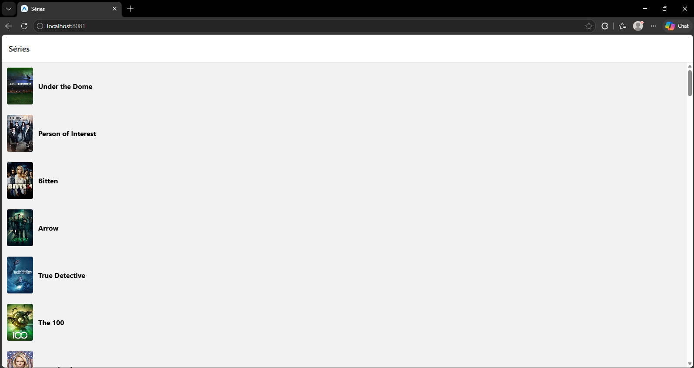
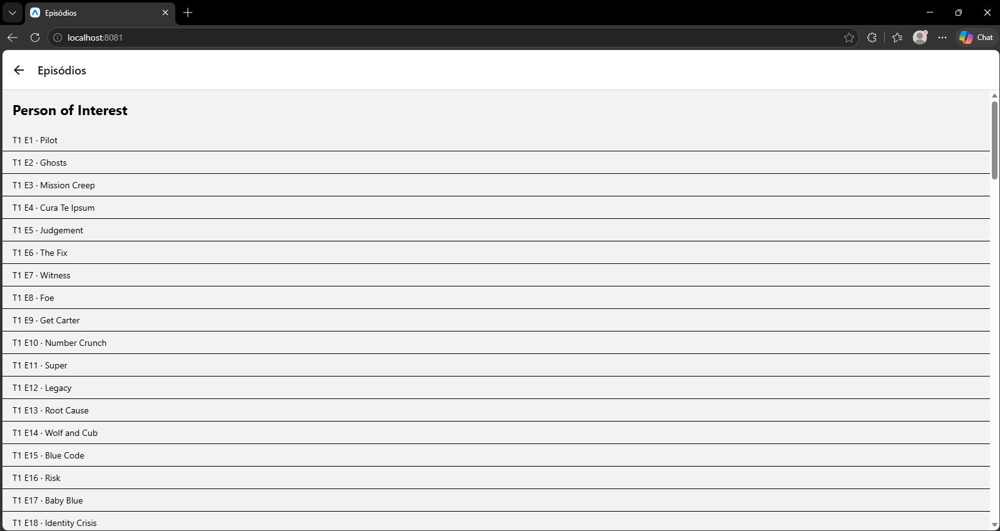

# CheckPoint 3 - TVmaze

Aplicativo em React Native (Expo) que consome a API pública do [TVmaze](https://www.tvmaze.com/api) para listar séries e mostrar os episódios de cada uma.

## funcionalidades

- listar as séries obtidas em `https://api.tvmaze.com/shows`, com imagem e nome
- tocar em uma série para abrir a tela de detalhe
- listar os episódios da série (temporada, número e nome) a partir de `https://api.tvmaze.com/shows/{id}/episodes`
- mostrar `ActivityIndicator` enquanto os dados carregam
- mostrar mensagem de erro caso a requisição falhe
- tratar dados `null` (série sem imagem mostra um quadrado cinza; episódio especial sem número mostra `-`)

## Requisitos técnicos

- Navegação com Stack Navigator (@react-navigation/native-stack).
- Listas implementadas com FlatList.
- Dados obtidos com fetch dentro de useEffect, usando async/await.
- Uso de try/catch/finally para gerenciamento de erros.
- Em ambas as telas, exibir ActivityIndicator durante o carregamento e uma mensagem em caso de erro.
- O id da série deve ser enviado à tela de detalhe por parâmetro de navegação (route.params) e usado para montar a URL com template literal.
- Tratar dados que podem ser null, como image, para que o aplicativo não seja encerrado.

## Critérios de avaliação

- O repositório contém o projeto completo e histórico de commits.
- Os prints mostram a listagem e o detalhe com episódios.
- Stack Navigation funcionando entre as duas telas.
- Consumo das duas APIs com fetch dentro de useEffect.
- Tratamento de carregamento e de erro nas duas telas.
- Organização e clareza do código.
- A utilização de IA estará sujeita a descontos na nota final
- Prazo: 28/10/2026

## estrutura do projeto

```
Checkpoint 3/
├── App.js
├── prints/
│   ├── lista.png
│   └── detalhe.png
├── telas/
│   ├── listaTelas.js 
│   └── detalhes.js 
└── README.md
```

## prints
### Lista de séries

### Detalhe com episódios


## como rodar

1. clone o repositório:

```bash
git clone https://github.com/juiyya/Cross-Platform-Application-Development
```

2. entre na pasta do projeto:

```bash
cd Checkpoint 3
```

3. instale as dependências:

```bash
npm install
npx expo install react-dom react-native-web
```

4. inicie o projeto:

```bash
npx expo start
```

5. abra o aplicativo pelo **Expo Go** usando o QR Code ou pressione `w` para abrir no navegador.


